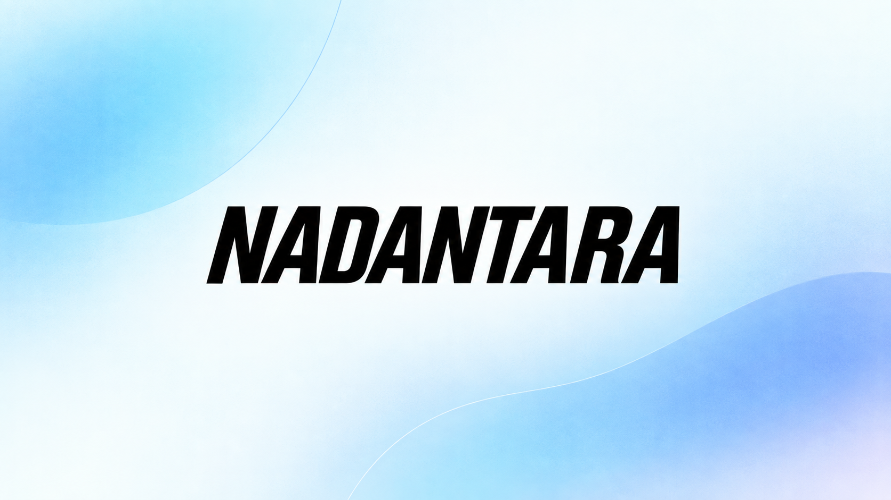

# Nadantara



Nadantara is a compact English-to-Hindi speech translation system designed for
deployment on low-power ARM hardware. The target runtime is an audio-in/audio-out
pipeline that can eventually be exported to Core ML or TensorRT.

```text
English waveform
      ↓
log-Mel frontend → compact Conformer speech encoder
      ↓
autoregressive Hindi semantic decoder
      ↓
Hindi speech units → vocoder → Hindi waveform
```

The repository is currently focused on the semantic translation stage and its
supervision experiments. A successful teacher experiment is not yet a production
speech-to-speech model: the Hindi unit decoder and vocoder still require their own
validated data, training, and end-to-end evaluation.

## Project status

The repository contains:

- a small UnitY-style PyTorch model graph with deterministic audio/data contracts;
- MPS, CUDA, and CPU device selection in the runtime/model code;
- a Hindi SentencePiece unigram tokenizer with 2,000 vocabulary items;
- a 2.69M-parameter semantic student configuration;
- reproducible training/evaluation entry points and checkpoint metadata;
- teacher benchmarking and resumable sequence-level distillation scripts.

The current real-data semantic baseline was trained from scratch on 1,736 English
speech/Hindi-text training pairs with 264 validation examples. The recorded baseline
is approximately BLEU 0.56, chrF2 13.31, repetition 24%, and 100% EOS rate. These
values are development measurements, not a claim of production quality.

The fixed 100-example teacher benchmark currently records:

| Teacher | Pipeline | BLEU | chrF2 |
| --- | --- | ---: | ---: |
| A | Whisper Large-v3 Turbo → IndicTrans2 | 11.50 | 34.59 |
| B | SeamlessM4T-v2 Large | 14.48 | 36.80 |

Teacher A also recorded approximately 12.99% WER and 4.56% CER on available English
references. Teacher A and Teacher B use the same held-out benchmark; those examples
must not enter pseudo-training.

The teacher scores are evidence that the supervision is stronger than the current
student baseline. They do not predict the final student score: the compact student,
2K tokenizer, optimization schedule, and audio-domain mismatch remain experimental
variables.

## Quick start

Create a development environment and run the repository tests:

```bash
python3 -m venv .venv
source .venv/bin/activate
python -m pip install -e '.[dev]'
pytest
```

Inspect the runtime and validate a mono, 16-bit, 16 kHz PCM WAV:

```bash
seamtranslation inspect
seamtranslation passthrough input.wav output.wav
```

The package has no model weights in Git. Training and teacher scripts download model
weights into the local Hugging Face cache or the temporary Colab runtime; experiment
artifacts are persisted separately.

## Repository layout

```text
src/seamtranslation/       reusable runtime, preprocessing, models, and contracts
train/                      semantic trainer and versioned model configurations
experiments/distillation/   teacher and student experiment scripts
dataset/                    small checked-in manifests and provenance metadata
artifacts/tokenizers/       current Hindi-2K tokenizer
docs/                       product, architecture, data, and evaluation decisions
tests/                      deterministic unit and smoke tests
```

Important project decisions are documented in:

- [Product definition](docs/product.md)
- [Architecture](docs/architecture.md)
- [Model specification](docs/model-spec.md)
- [Evaluation contract](docs/evaluation.md)
- [Dataset audit](docs/dataset-audit.md)
- [Distillation workflow](experiments/distillation/README.md)
- [Contributor and agent instructions](AGENTS.md)

## Distillation experiment

The first distillation experiment compares two separate fresh students against the
real-data baseline:

```text
fixed WordProject audio selection
          ├── Teacher A: Whisper → IndicTrans2 → Hindi text → Student A
          └── Teacher B: SeamlessM4T-v2 → Hindi text → Student B
```

Both students use the same:

- deterministic 10,000-example source selection;
- held-out benchmark exclusion;
- Hindi-2K tokenizer and 128-token semantic limit;
- 2.69M architecture;
- random seed, optimizer, schedule, and two-stage training policy.

The only intended experimental difference is teacher supervision. WordProject Hindi
text is retained for diagnostics, but it is not used as the pseudo-training target.
Teacher A and Teacher B labels are stored separately and are joined only by
`sample_id` after both label sets have passed quality filtering.

The scripts run in two stages:

1. pseudo-label pretraining on teacher-generated Hindi text;
2. real-data fine-tuning on the existing 1,736-example Nadantara training set.

They save incrementally and resume by `sample_id`, so a runtime interruption does not
require regenerating completed labels.

### Colab execution

Prepare the small source bundle locally:

```bash
PYTHONPATH=. .venv/bin/python \
  experiments/distillation/prepare_colab_source_bundle.py \
  --output /tmp/nadantara_source.tar.gz
```

Upload the following to Colab:

- `experiments/distillation/train_student_teacher_a_colab.py` or B;
- `experiments/distillation/colab_common.py`;
- `/tmp/nadantara_source.tar.gz`.

Create a Colab Secret named `HF_TOKEN`. The token must have access to the pinned
WordProject and teacher model repositories. The scripts require a CUDA runtime.

Run in this order:

1. Teacher A script: generate and persist A labels, then stop at the fairness gate.
2. Teacher B script: reuse the exact shared selection, generate B labels, and train
   Student B once both filtered manifests exist.
3. Rerun Teacher A script: reuse A labels and train Student A on the common usable
   intersection.

If the two Gmail accounts differ, share `MyDrive/Nadantara/distillation` with the
second account and add it as a shortcut at the same path. Set this before `%run` if
needed:

```python
import os
os.environ["NADANTARA_DRIVE_ROOT"] = "/content/drive/MyDrive/Nadantara/distillation"
```

### Continue on a local NVIDIA GPU

Colab GPU quota exhaustion does not invalidate records already flushed to Drive.
Download or sync the entire `Nadantara/distillation` folder to a local SSD. For
Teacher B resume, these paths are required:

```text
shared_wordproject_10k/selection/                 # manifest and all selected audio
shared_wordproject_10k/real_data/                 # real train/validation audio
student_a_whisper_indictrans/dataset/pseudo_train_filtered.jsonl
student_b_seamless_m4t/dataset/teacher_b_pseudo_10k.jsonl
```

The last file may be partial. The local script skips its completed records and
continues with the remaining sample IDs. Model weights are downloaded from
Hugging Face locally; they do not need to be copied from Colab.

From the repository checkout:

```bash
export HF_TOKEN="hf_..."
export NADANTARA_DRIVE_ROOT="/path/to/local/distillation"
export NADANTARA_SOURCE_ROOT="/path/to/seamTranslation"

python experiments/distillation/train_student_teacher_b_colab.py
python experiments/distillation/train_student_teacher_a_colab.py
```

The scripts retain their Colab-compatible names for continuity, but they detect the
local environment and do not import `google.colab` when `NADANTARA_DRIVE_ROOT` is set.
The local PyTorch installation must be CUDA-enabled:

```bash
python -c "import torch; print(torch.cuda.is_available()); print(torch.cuda.get_device_name(0) if torch.cuda.is_available() else 'NO CUDA GPU')"
```

If the laptop has less VRAM than the T4, SeamlessM4T may use CPU offload through
`device_map="auto"` and run more slowly. A model-load OOM is a hardware/memory
constraint, not evidence that the persisted labels were lost.

For the complete artifact list, resume behavior, filtering policy, and provenance
fields, see [experiments/distillation/README.md](experiments/distillation/README.md).

## Reproducibility and data boundaries

Every experiment records the dataset revision, source/license metadata, selected-ID
hash, manifest hashes, tokenizer hash, model revisions, decoding configuration,
runtime versions, seed, training configuration, checkpoint hash, and hardware when
available.

The current controls are:

- WordProject revision is pinned to `82398593980643a685816a77236adaa05591b12d`;
- Teacher A revisions are pinned for Whisper and IndicTrans2;
- Teacher B is pinned to the SeamlessM4T-v2 revision used in the benchmark;
- the 100 benchmark IDs are excluded from pseudo-training;
- duplicate audio and current real-data rows are excluded from the 10K selection;
- labels are audited for empty output, wrong script, source copying, length overflow,
  and repeated 1/2/3/4-grams;
- labels exceeding 128 Hindi-2K semantic tokens are flagged and excluded from the
  first student experiment;
- Teacher A and Teacher B pseudo corpora remain separate.

Do not commit audio corpora, model checkpoints, Hugging Face caches, tokens, or large
generated JSONL artifacts to Git. Keep them in Drive or another controlled artifact
store and preserve the generated metadata alongside them.

## Testing

Run the full test suite before changing model or data code:

```bash
PYTHONPATH=src:. .venv/bin/python -m pytest -q
python3 -m py_compile experiments/distillation/*.py train/train_semantic.py
git diff --check
```

The tests validate deterministic model behavior, data contracts, preprocessing, and
training utilities. They do not replace GPU teacher generation or end-to-end speech
quality evaluation.

## License and provenance

The repository is Apache-2.0. Dataset and teacher licenses are separate from the
repository license and must remain in experiment metadata:

- WordProject: CC BY 4.0;
- Whisper: MIT;
- IndicTrans2: MIT;
- SeamlessM4T-v2: CC BY-NC 4.0.

The SeamlessM4T teacher and any derived checkpoint require a separate downstream
license review. This README does not make a redistribution or commercial-use claim
for third-party data, teacher outputs, or distilled weights.
