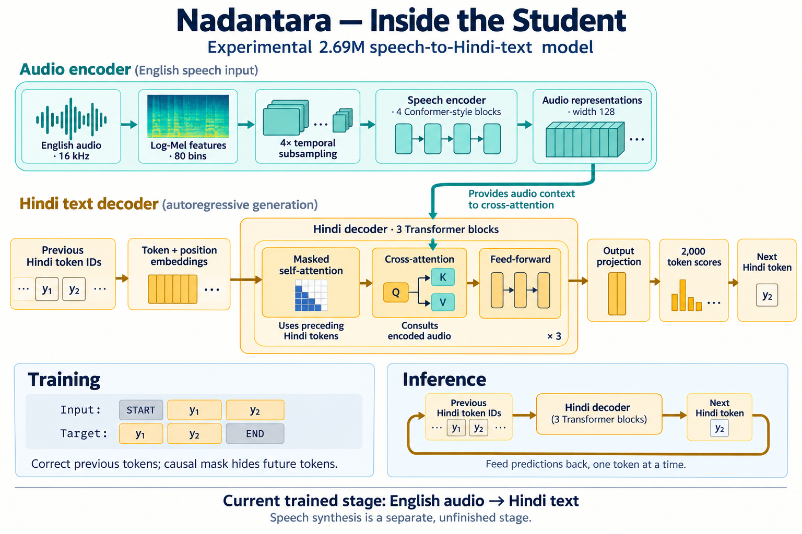
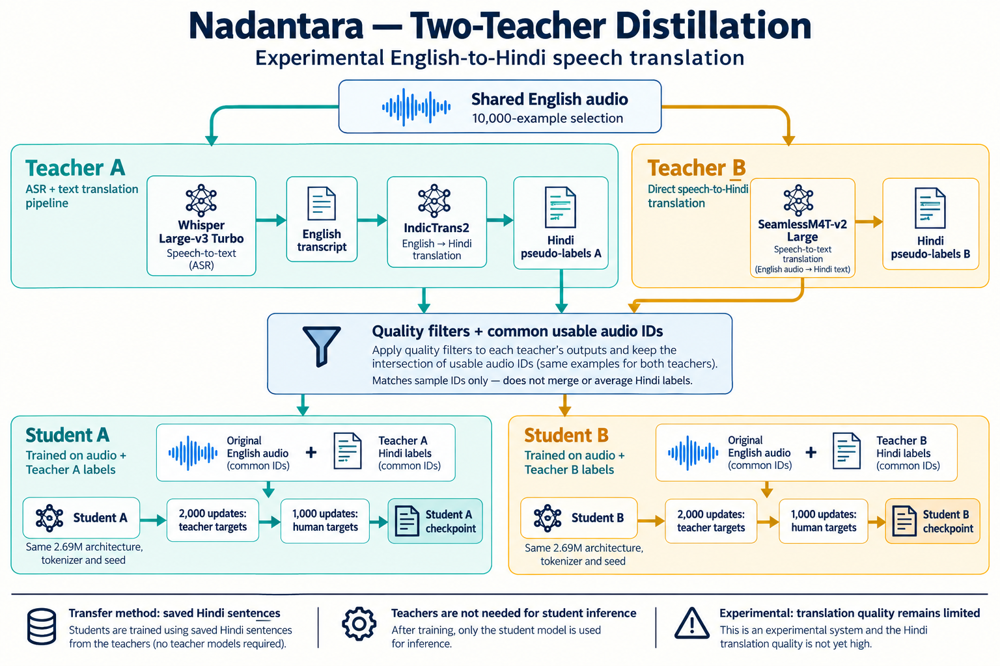

# Nadantara


**Experimental English-to-Hindi speech translation through knowledge distillation.**

Nadantara investigates whether a compact speech translation student can learn from
two teacher pipelines: **Whisper Large-v3 Turbo → IndicTrans2** and
**SeamlessM4T-v2 Large**. Each teacher supervises a separate student, allowing a
controlled comparison of teacher-generated Hindi targets.

**Status: experimental and incomplete.** Current student outputs still contain
repetition and fail to reliably preserve source meaning. This repository contains
model code, training scripts, evaluation tools, and experiment records; it does
not provide a ready-to-use translator.

The implemented student training path is:

```text
English waveform
      ↓
log-Mel frontend → compact Conformer speech encoder
      ↓
autoregressive Hindi semantic decoder
      ↓
Hindi text
```



*Student architecture. Audio representations supply context to cross-attention;
previous Hindi tokens enter masked self-attention. Token symbols are schematic.*

Offline speech-to-speech translation on constrained hardware remains the longer-term
target. Hindi speech-unit generation and vocoding still require validated data,
training, and end-to-end evaluation. Core ML/TensorRT export, memory budgets, and
runtime performance are goals rather than demonstrated deployment capabilities.

## Project status

The repository contains:

- a small UnitY-style PyTorch model graph with deterministic audio/data contracts;
- MPS, CUDA, and CPU device selection in the runtime/model code;
- a Hindi SentencePiece unigram tokenizer with 2,000 vocabulary items;
- a 2.69M-parameter semantic student configuration;
- reproducible training/evaluation entry points and checkpoint metadata;
- teacher benchmarking and resumable sequence-level distillation scripts.

The real-data semantic baseline was trained from scratch on 1,736 English
speech/Hindi-text training pairs with 264 validation examples. Distillation adds
teacher-generated labels from a separate shared audio selection, followed by
fine-tuning on the human-reference training set.

## Recorded experiments

Scores below are recorded development measurements. BLEU and chrF2 use a 0–100
scale; higher is better. The 100-example and 264-example evaluations are different
sets and should not be compared as a single model ranking. Data is drawn from
WordProject's Bible-text domain; these results do not establish general speech
translation quality.

### Teacher benchmark — 100 examples

The fixed 100-example teacher benchmark currently records:

| Teacher | Pipeline | BLEU | chrF2 |
| --- | --- | ---: | ---: |
| A | Whisper Large-v3 Turbo → IndicTrans2 | 11.50 | 34.59 |
| B | SeamlessM4T-v2 Large | 14.48 | 36.80 |

The teachers use the same fixed benchmark, whose IDs are excluded from
pseudo-training. Machine-readable records: [Teacher A metrics](teacher_a_100_artifacts/outputs/teacher_a_metrics.json)
and [Teacher B metrics](teacher_b_100_artifacts/outputs/teacher_b_metrics.json).

### Distilled students — 100 examples

The quality audit records the following before and after adding repeated-trigram
blocking to decoding. The checkpoints were unchanged; no retraining was involved.

| Student | Teacher supervision | BLEU before → after | chrF2 before → after |
| --- | --- | ---: | ---: |
| A | Whisper → IndicTrans2 | 0.756 → 1.365 | 8.745 → 11.449 |
| B | SeamlessM4T-v2 | 0.450 → 1.135 | 9.057 → 14.924 |

Repetition decreased, but outputs still failed to reliably preserve meaning.
See the [translation quality audit](docs/translation-quality-audit.md) for the
recorded results and proposed follow-up experiments. Suspected contributors in
that audit are hypotheses unless supported by an executed comparison.

### Additional baseline experiments — 264 validation examples

These experiments used the real-data baseline, not the distilled Student A/B
checkpoints.

| Experiment | BLEU | chrF2 |
| --- | ---: | ---: |
| Original 2.69M baseline, step 2900 | 1.141 | 14.201 |
| 1,000-step continuation, best validation-loss checkpoint | 1.138 | 13.907 |
| 1,000-step continuation, final checkpoint | 1.197 | 13.781 |
| Frozen random Whisper encoder + trained adapter/decoder | 0.915 | 13.929 |
| Frozen pretrained Whisper encoder + trained adapter/decoder | 0.956 | 13.784 |

The continuation reduced validation loss without a useful translation-quality
gain. The frozen pretrained encoder did not improve chrF2 over its matched random
control under the tested 1,000-step budget. The frozen-encoder models contain
9.32M total parameters, including 8.21M frozen parameters; they are separate
architectures from the 2.69M baseline.

Records: [continuation report](train/diagnostics/local_continuation_summary.md),
[frozen-encoder report](train/diagnostics/pretrained_encoder_summary.md), and
[comparison metrics](train/diagnostics/pretrained_encoder_comparison.json).
These bounded experiments do not establish model capacity as the bottleneck or
rule out other pretrained or fine-tuning approaches.

Current follow-up work focuses on source/target alignment review and comparing
teacher translation from verified English transcripts with translation from ASR
transcripts. The [data audit script](experiments/teachers/audit_translation_data.py)
prepares review bundles and paired evaluation. Human review and the paired
IndicTrans2 diagnostic remain pending; no new quality result is claimed for them.

## Quick start

Create a development environment and run the repository tests:

```bash
python3 -m venv .venv
source .venv/bin/activate
python -m pip install -e '.[dev,training]'
pytest
```

Inspect the runtime and validate a mono, 16-bit, 16 kHz PCM WAV:

```bash
seamtranslation inspect
seamtranslation passthrough input.wav output.wav
```

The passthrough command validates audio transport; it does not translate speech.
The package has no student checkpoints or runnable translator weights in Git.
Training also requires the dataset audio and a matching tokenizer artifact; see
[training setup](train/README.md) and [distillation setup](experiments/distillation/README.md).
Teacher scripts download model
weights into the local Hugging Face cache or the temporary Colab runtime; experiment
artifacts are persisted separately.

## Repository layout

```text
src/seamtranslation/       reusable runtime, preprocessing, models, and contracts
train/                      semantic trainer and versioned model configurations
experiments/distillation/   teacher and student experiment scripts
dataset/                    small checked-in manifests and provenance metadata
model_registry/             model/tokenizer metadata
artifacts/                  ignored local tokenizers and generated artifacts
docs/                       product, architecture, data, and evaluation decisions
tests/                      deterministic unit and smoke tests
```

Important project decisions are documented in:

- [Product definition](docs/product.md)
- [Architecture](docs/architecture.md)
- [Model specification](docs/model-spec.md)
- [Evaluation contract](docs/evaluation.md)
- [Dataset audit](docs/dataset-audit.md)
- [Distillation workflow](experiments/distillation/README.md)

## Distillation experiment



*Distillation workflow. The diagram shows the default selection and update budget.
The final usable sample count depends on filtering; teacher labels stay separate.*

The method is **offline sequence-level distillation**: each teacher generates Hindi
sentences, which are saved as pseudo-labels. Students train on the original English
audio and those Hindi targets using token cross-entropy. Teacher weights, hidden
features, and token-probability distributions are not transferred to the students.
The two teachers are experimental alternatives, not an ensemble used at inference.

The first distillation experiment compares two separate fresh students against the
real-data baseline:

```text
fixed WordProject audio selection
          ├── Teacher A: Whisper → IndicTrans2 → Hindi text → Student A
          └── Teacher B: SeamlessM4T-v2 → Hindi text → Student B
```

Both students use the same:

- deterministic 10,000-example source selection;
- held-out benchmark exclusion;
- Hindi-2K tokenizer and 128-token semantic limit;
- 2.69M architecture;
- random seed, optimizer, schedule, and two-stage training policy.

The only intended experimental difference is teacher supervision. WordProject Hindi
text is retained for diagnostics, but it is not used as the pseudo-training target.
Teacher A and Teacher B labels remain separate. After filtering, both students
train on the same intersection of usable audio IDs, retaining their own teacher's
Hindi target for each example. Automated filters do not establish semantic accuracy.

The scripts run in two stages:

1. Pseudo-label training from a fresh student on teacher-generated Hindi text
   (default: 2,000 optimizer updates).
2. Continue the same student on the existing 1,736-example human-reference training
   set (default: 1,000 further updates).

Only the student is needed for its intended inference path. A completed training
run is not evidence of a ready model; translation quality must be evaluated.

They save incrementally and resume by `sample_id`, so a runtime interruption does not
require regenerating completed labels.

### Colab execution

Prepare the small source bundle locally:

```bash
PYTHONPATH=. .venv/bin/python \
  experiments/distillation/prepare_colab_source_bundle.py \
  --output /tmp/nadantara_source.tar.gz
```

Upload the following to Colab:

- `experiments/distillation/train_student_teacher_a_colab.py` or B;
- `experiments/distillation/colab_common.py`;
- `/tmp/nadantara_source.tar.gz`.

Create a Colab Secret named `HF_TOKEN`. The token must have access to the pinned
WordProject and teacher model repositories. The scripts require a CUDA runtime.

Run in this order:

1. Teacher A script: generate and persist A labels, then stop at the fairness gate.
2. Teacher B script: reuse the exact shared selection, generate B labels, and train
   Student B once both filtered manifests exist.
3. Rerun Teacher A script: reuse A labels and train Student A on the common usable
   intersection.

If the two Gmail accounts differ, share `MyDrive/Nadantara/distillation` with the
second account and add it as a shortcut at the same path. Set this before `%run` if
needed:

```python
import os
os.environ["NADANTARA_DRIVE_ROOT"] = "/content/drive/MyDrive/Nadantara/distillation"
```

### Continue on a local NVIDIA GPU

Colab GPU quota exhaustion does not invalidate records already flushed to Drive.
Download or sync the entire `Nadantara/distillation` folder to a local SSD. For
Teacher B resume, these paths are required:

```text
shared_wordproject_10k/selection/                 # manifest and all selected audio
shared_wordproject_10k/real_data/                 # real train/validation audio
student_a_whisper_indictrans/dataset/pseudo_train_filtered.jsonl
student_b_seamless_m4t/dataset/teacher_b_pseudo_10k.jsonl
```

The last file may be partial. The local script skips its completed records and
continues with the remaining sample IDs. Model weights are downloaded from
Hugging Face locally; they do not need to be copied from Colab.

From the repository checkout:

```bash
export HF_TOKEN="hf_..."
export NADANTARA_DRIVE_ROOT="/path/to/local/distillation"
export NADANTARA_SOURCE_ROOT="/path/to/seamTranslation"

python experiments/distillation/train_student_teacher_b_colab.py
python experiments/distillation/train_student_teacher_a_colab.py
```

The scripts retain their Colab-compatible names for continuity, but they detect the
local environment and do not import `google.colab` when `NADANTARA_DRIVE_ROOT` is set.
The local PyTorch installation must be CUDA-enabled:

```bash
python -c "import torch; print(torch.cuda.is_available()); print(torch.cuda.get_device_name(0) if torch.cuda.is_available() else 'NO CUDA GPU')"
```

If the laptop has less VRAM than the T4, SeamlessM4T may use CPU offload through
`device_map="auto"` and run more slowly. A model-load OOM is a hardware/memory
constraint, not evidence that the persisted labels were lost.

For the complete artifact list, resume behavior, filtering policy, and provenance
fields, see [experiments/distillation/README.md](experiments/distillation/README.md).

## Reproducibility and data boundaries

Every experiment records the dataset revision, source/license metadata, selected-ID
hash, manifest hashes, tokenizer hash, model revisions, decoding configuration,
runtime versions, seed, training configuration, checkpoint hash, and hardware when
available.

The current controls are:

- WordProject revision is pinned to `82398593980643a685816a77236adaa05591b12d`;
- Teacher A revisions are pinned for Whisper and IndicTrans2;
- Teacher B is pinned to the SeamlessM4T-v2 revision used in the benchmark;
- the 100 benchmark IDs are excluded from pseudo-training;
- duplicate audio and current real-data rows are excluded from the 10K selection;
- labels are audited for empty output, wrong script, source copying, length overflow,
  and repeated 1/2/3/4-grams;
- labels exceeding 128 Hindi-2K semantic tokens are flagged and excluded from the
  first student experiment;
- Teacher A and Teacher B pseudo corpora remain separate.

Do not commit audio corpora, model checkpoints, Hugging Face caches, tokens, or large
generated JSONL artifacts to Git. Keep them in Drive or another controlled artifact
store and preserve the generated metadata alongside them.

## Testing

Run the full test suite before changing model or data code:

```bash
PYTHONPATH=src:. .venv/bin/python -m pytest -q
python3 -m py_compile experiments/distillation/*.py train/train_semantic.py
git diff --check
```

The tests validate deterministic model behavior, data contracts, preprocessing, and
training utilities. They do not replace GPU teacher generation or end-to-end speech
quality evaluation.

## License and provenance

Original repository code is licensed under [Apache-2.0](LICENSE). See
[third-party attribution](THIRD_PARTY.md) for the benchmark data, teacher sources,
and explanatory images. Dataset and teacher licenses are separate from the
repository license and must remain in experiment metadata:

- WordProject: CC BY 4.0;
- Whisper: MIT;
- IndicTrans2: MIT;
- SeamlessM4T-v2: CC BY-NC 4.0.

The two existing benchmark archives under `teacher_a_100_artifacts/` and
`teacher_b_100_artifacts/` contain the same 100-example WordProject audio subset.
Their data attribution and preprocessing changes are documented in
[THIRD_PARTY.md](THIRD_PARTY.md); the code license does not replace the data license.

The SeamlessM4T teacher and any derived checkpoint require a separate downstream
license review. This README does not make a redistribution or commercial-use claim
for third-party data, teacher outputs, or distilled weights.
